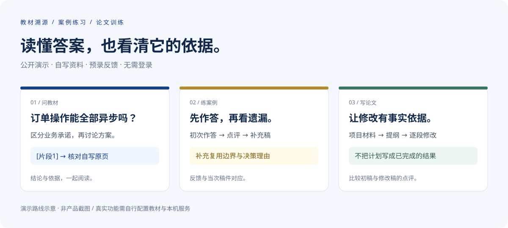

# 软考 AI 学习助手

**教材溯源 · 案例练习 · 论文训练**

面向系统架构设计师备考的 AI 学习工作台：回答附可点击的教材原页，案例先自己作答再看点评，论文基于真实项目经历逐段修改。

**[立即体验公开演示](https://ruankao-40-day.xiaoydian.chatgpt.site/demo)** · [快速开始](#快速开始) · [功能清单](docs/features.zh-CN.md) · [反馈问题](https://github.com/xiaoyudian001/ruankao/issues)

*上图为演示路线示意。公开页面无需登录，使用自写资料、合成项目和预录反馈；电脑离线时也能浏览，不提供公共实时问答。*

**English:** A study workspace for China's System Architect exam, with source-linked RAG answers, case practice and essay revision. The public demo uses authored sample notes and prerecorded feedback. Live features require a self-hosted connector and your own materials. [Deployment guide (Chinese)](docs/setup.zh-CN.md).

## 三个场景，先体验再看实现

### 1. 问教材：结论可以回到原页

在真实实例中，问题经教材检索后交给 MiniMax 生成回答，蓝色引用打开原 PDF 页与检索文本，同时显示教材印刷页码和 PDF 物理页码。

**演示操作**：打开[教材问答演示](https://ruankao-40-day.xiaoydian.chatgpt.site/demo)，阅读“订单写入和通知发送，可以都改成异步吗？”，点击片段引用核对自写原页。

### 2. 练案例：先作答，再补齐遗漏

共享同一段背景，逐问提交自己的答案，再查看答对、遗漏和概念错误。修改后可以再次点评，材料与原稿快照保留在训练记录中。

**演示操作**：切换“案例练习”，提交初次作答，阅读反馈；再提交补充后的示例答案，比较两次点评。演示稿固定，不对访客自由输入伪装评分。

### 3. 写论文：把项目事实与技术理由写清楚

保存真实项目材料，生成切题提纲，分别练习摘要、背景与职责、架构方案、实施过程和总结。点评会提示缺少的事实和技术论证，修改后再次提交保留历史版本。

**演示操作**：切换“论文训练”，展开提纲，比较初稿与修改稿。合成经历不能代替真实项目，不提供官方分数或通过率预测。

## 当前能力

| 模块 | 已实现 |
| --- | --- |
| 教材 RAG | 语义检索；完整模式结合 BM25、RRF、本地重排与上下文扩展 |
| AI 知识补充 | 教材不足时最多补检索一次，再提供明确标记、无教材页码的通用解释 |
| 来源核对 | 蓝色引用、教材/PDF 双页码、原页与证据文本并排查看 |
| 图文问答 | 图示、表格及公式原页检索，读取相关原图后回答 |
| 多题型解析 | 选择、问答、案例、计算、判断、填空；支持核对后的题目截图 |
| 案例与论文 | 先答后评、修改再评、版本快照和教材依据 |
| 复习闭环 | 答案收藏、复习卡片、主动回忆、自评与 AI 点评 |
| 40 天计划 | 每日打卡、阶段路线、学习时长与刷题统计 |

详细范围与限制见[功能清单](docs/features.zh-CN.md)。公开源码不包含教材、OCR 全文、向量数据、模型权重、用户记录或真实密钥。

## 快速开始

### 只想了解产品

直接打开[公开演示](https://ruankao-40-day.xiaoydian.chatgpt.site/demo)。不需要安装、不需要登录，也不会调用你的模型账号。[演示说明](docs/public-demo.zh-CN.md)

### 本地查看前端与演示

需要 Node.js >=22.13.0 和 pnpm@11.25.0：

~~~sh
git clone https://github.com/xiaoyudian001/ruankao.git
cd ruankao
pnpm install --frozen-lockfile
pnpm dev
~~~

打开 http://localhost:5173/demo 即可体验样例。此步骤启动前端，不等于完成真实教材问答的配置。

### 配置自己的真实问答

网页运行在 Cloudflare Workers，D1/R2 保存记录与文件。本机连接器主动领取任务，调用 Langflow、Ollama 和配置的 MiniMax 服务。当前在线学习空间仅供网站所有者使用；克隆仓库不会取得其数据或访问权限。

需自行准备云端绑定、登录与连接配置、Langflow 流程、教材索引、模型和供应商密钥。现有脚本仍含本机路径及固定流程 ID，Python 依赖尚未经过全新机器完整复现。**当前不是一键安装方案。** 逐项配置见[运行与部署说明](docs/setup.zh-CN.md)。

## 一次回答怎样产生

~~~text
网页提问 → 云端队列 → 本机连接器
  → 教材检索 → MiniMax 生成 → 引用校验与输出清理
  → 云端保存 → 网页答案与可点击原页
~~~

- **嵌入与向量库**：Ollama BGE-M3、Langflow 管理的 Chroma Local。
- **完整检索**：按需拆分复杂问题，结合语义召回与 BM25，RRF 融合，再用 mmarco-mMiniLMv2-L12-H384-v1 重排。
- **回答与图文**：现有实例使用 MiniMax-M3；ChatGPT 登录用于身份验证。
- **网络连接**：连接器主动发送 HTTPS 请求，不把本机 Langflow/Ollama 端口直接公开。
- **网页与存储**：TypeScript、React、Vinext/Vite、Tailwind、Cloudflare Workers/D1/R2。

公开演示只展示固定样例，不经过以上实时链路。深入机制见[项目实现说明](docs/project-details.zh-CN.md)。

## 验证与边界

~~~sh
node --experimental-strip-types --test tests/*.test.mjs
node tests/demo-render.mjs
node tests/essay-routes.mjs
node tests/case-routes.mjs
python -m unittest discover -s tests -p 'test_*.py'
~~~

测试覆盖数据契约、实际路由、权限、队列、训练快照和演示渲染。连接器测试及真实模型验证需要另备 Python 环境、模型与资料；私有图示语料相关检查可能跳过。详情见[实现说明](docs/project-details.zh-CN.md#验证)。

当前限制：

- 真实新问答依赖本机联网与服务在线；公开演示不受这一限制。
- 教材、训练和复习接口有所有者检查；首页打卡与资料仍是单套共享数据，尚未实现多用户隔离。公开演示不读取这些接口。
- 回答和点评属于 AI 辅助，识别题干、公式与引用仍应核对，不按官方评分细则精确计分。
- 复习日历日期仍需按自己的考试周期调整。
- 完整浏览器交互验证尚未完成。源码公开不等于已完成新机器部署验证。

## 文档导航

- [公开演示与分享](docs/public-demo.zh-CN.md)
- [功能清单](docs/features.zh-CN.md)
- [本地运行与部署](docs/setup.zh-CN.md)
- [案例逐问练习](docs/case-study.zh-CN.md)
- [论文写作训练](docs/essay-training.zh-CN.md)
- [教材优先与 AI 兜底](docs/qa-ai-fallback.zh-CN.md)
- [详细机制、目录与测试](docs/project-details.zh-CN.md)
- [框架运行说明](docs/framework.zh-CN.md)

## 参与与许可

欢迎通过 [Issues](https://github.com/xiaoyudian001/ruankao/issues) 提交可复现问题。请附输入示例、运行环境和脱敏错误信息；不要上传真实密钥、个人项目材料或未经许可的教材。

项目尚未单独声明代码许可证，因此目前不宣称为具有明确许可的开源发行版。第三方组件声明保留在相应目录；教材、模型和服务的条件分别适用。许可证、脱敏流程模板与新机器安装验证是后续发布准备事项。
